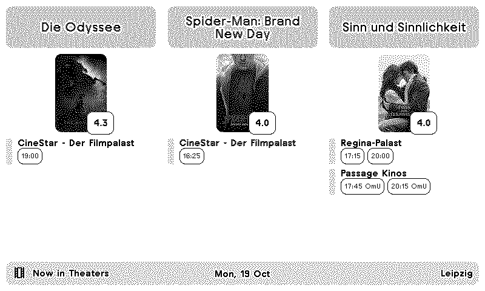

# TRMNL Cinema Plugin

## Overview

A plugin for [TRMNL displays](https://trmnl.com/) that shows the highest-rated movies currently screening in your city's cinemas. It reads the programme of any German city from [cinema.de](https://www.cinema.de/), ranks the films by their [Letterboxd](https://letterboxd.com/) rating and shows the best ones (three on TRMNL OG, four on TRMNL X) with the showtimes that are still to come.

> **Note**: This is a personal learning project by a C++ developer exploring TRMNL plugin development. While functional, the code may not follow all best practices. Feedback, contributions, and suggestions are welcome!



## Features

- The best-rated films of the day, three on TRMNL OG and four on TRMNL X, each with its cinemas and the showtimes still to come. After the last screening of the day, tomorrow's programme is shown.
- Works for every town and city on cinema.de.
- Version tags such as `OmU`, `OV`, `3D` or `70mm` next to each showtime.
- Optional: hide films you logged on Letterboxd recently, list your preferred cinemas first, exclude cinemas.
- Full, half and quadrant layouts in landscape and portrait, for TRMNL OG and TRMNL X. The title bar shows the date and the city.
- Runs entirely on TRMNL's servers: there is nothing to host.

## Settings

| Field | Description |
|---|---|
| City | The city as cinema.de names it, e.g. `Leipzig`, `München` or `Frankfurt am Main`. A cinema.de programme URL works too, e.g. for `halle-saale`. |
| Letterboxd Username | Optional. Films you logged on Letterboxd recently are hidden. |
| Hide Films Watched Within (Days) | How far back your Letterboxd diary counts as recently watched. Default 180. |
| Preferred Cinemas | Optional. Listed first under each film, in this order. Part of the name is enough, e.g. `Schauburg`. |
| Excluded Cinemas | Optional. Screenings at these cinemas are hidden; a film shown only there drops out. Part of the name is enough. |

## How It Works

- **Data**: On every refresh (hourly), TRMNL runs [src/transform.py](src/transform.py) as a [serverless transform](https://help.trmnl.com/en/articles/14130649-serverless). It scrapes the configured city's programme from cinema.de.
- **Ranking**: Each film is looked up on Letterboxd. Ratings are cached in TRMNL's [Saved State](https://help.trmnl.com/en/articles/16777795-saved-state), so a refresh only looks up films that are new in the programme.
- **Display**: The Liquid templates in [src/](src/) render the result with the [TRMNL design framework](https://trmnl.com/framework).
- **Deployment**: Every push to `main` that touches the plugin is linted, tested and pushed to TRMNL by [GitHub Actions](.github/workflows/trmnl.yml) with [trmnlp](https://github.com/usetrmnl/trmnlp).

## Use It Yourself

Once the plugin is published as a TRMNL Recipe, you can install it from TRMNL directly. Until then, run your own copy (private plugins need TRMNL's Developer edition):

1. Fork this repository.
2. On TRMNL, create a private plugin with the **Polling** strategy and an empty polling URL. Put the number from its settings URL (`trmnl.com/plugin_settings/<id>/edit`) as `id` into [src/settings.yml](src/settings.yml).
3. Create an account API key at [trmnl.com/account](https://trmnl.com/account) with the `read` and `content` capabilities, limited to that plugin. Add it to your fork as the repository secret `TRMNL_API_KEY`.
4. Push to `main` or start the workflow by hand: it lints, tests and uploads the plugin.
5. Fill in the plugin's settings, upload [assets/theaters.png](assets/theaters.png) as its icon and add it to a playlist.

## Project Structure

```
cinema/
├── .github/workflows/
│   └── trmnl.yml                # Lint, test and push the plugin to TRMNL
├── .vscode/
│   └── launch.json              # Debug the transform with live data, or the unit tests
├── assets/                      # Plugin icon for the TRMNL website (upload by hand)
├── bin/
│   ├── run_transform.py         # Runs the transform locally with live data
│   └── trmnlp                   # Runs the trmnlp CLI in Docker
├── src/                         # The plugin as TRMNL stores it
│   ├── settings.yml             # Plugin settings and custom fields
│   ├── transform.py             # Serverless transform: scraping, ranking, caching
│   ├── shared.liquid            # Styles and templates shared by all views
│   ├── full.liquid              # Full screen view
│   ├── half_horizontal.liquid   # Half views for mashups
│   ├── half_vertical.liquid
│   └── quadrant.liquid          # Quadrant view for mashups
├── tests/
│   ├── test_transform.py        # Unit tests for the transform (offline)
│   ├── plugin_spec.rb           # Rendering tests on all TRMNL devices (trmnlp test)
│   └── fixtures/                # Saved cinema.de page, test poster
├── .trmnlp.yml                  # Local preview settings (not pushed)
└── README.md
```

## Development

### Requirements

- [Docker](https://docs.docker.com/get-docker/) for `bin/trmnlp`. On Windows, run it from Git Bash.
- Python 3.12 with `requests` (TRMNL's serverless runtime uses Python 3.12)

### Run the transform locally

```bash
python bin/run_transform.py Leipzig                   # prints what the views get, with live data
python bin/run_transform.py Berlin your_letterboxd    # with a Letterboxd username
```

Keep `src/transform.py` free of an `if __name__ == "__main__":` block: TRMNL's runtime runs that file as a script, so such a block would run on every refresh.

In VS Code, the **Transform (live data)** and **Unit tests** launch configurations run the same under the debugger.

### Preview

```bash
bin/trmnlp serve        # live preview at http://localhost:4567, runs the real transform
bin/trmnlp build --png  # renders every view to _build/
```

The preview uses the custom field values from [.trmnlp.yml](.trmnlp.yml). Set `LETTERBOXD_USERNAME` in your environment to try the watched-films filter.

### Tests

```bash
python -m unittest discover -s tests   # transform unit tests, no network needed
bin/trmnlp lint                        # TRMNL best practices
bin/trmnlp test --report report        # renders all views on all devices; open report/index.html
```

The rendering tests mock cinema.de and Letterboxd. They deliberately don't freeze the clock with `now:`: trmnlp's frozen clock slows the transform down several times, which broke TRMNL's 5 second limit on GitHub's runners.

### Debugging on TRMNL

TRMNL logs every refresh with the transform's duration and the first few hundred characters of its output. Read them with an account API key that has the `read` capability:

```bash
curl -H "Authorization: Bearer $TRMNL_API_KEY" "https://trmnl.com/api/plugin_settings/<id>/logs?limit=10"
```

The output begins with `city_setting`, the city value TRMNL passed in, so a setting that doesn't seem to apply is easy to spot.

### Constraints of TRMNL's serverless runtime

- 5 seconds and 128 MB per run. The transform stops looking up films after 2.5 seconds and continues on the next refresh; all network calls run on daemon threads, so none can hold up the end of a run.
- Only `requests` and the Python standard library are available: HTML is parsed with `html.parser`, RSS with `xml.etree`.
- There is no time zone database, so German time is computed in `german_now()`.
- Saved State holds at most 8 KB. `build_state()` trims the rating cache to fit.

## Third-Party Assets

This project uses the **"theaters" icon from Material Symbols**: in TRMNL's orange as the plugin icon ([assets/theaters.svg](assets/theaters.svg), [assets/theaters.png](assets/theaters.png)) and inlined in the title bar  
© Google  
Licensed under the Apache License 2.0  
https://fonts.google.com/icons

Programme data comes from [cinema.de](https://www.cinema.de/), ratings and posters from [Letterboxd](https://letterboxd.com/).

## License

PolyForm Noncommercial 1.0.0 (no commercial use; attribution required)

See [LICENSE](LICENSE) (official text link) and [NOTICE](NOTICE) for attribution requirements.
